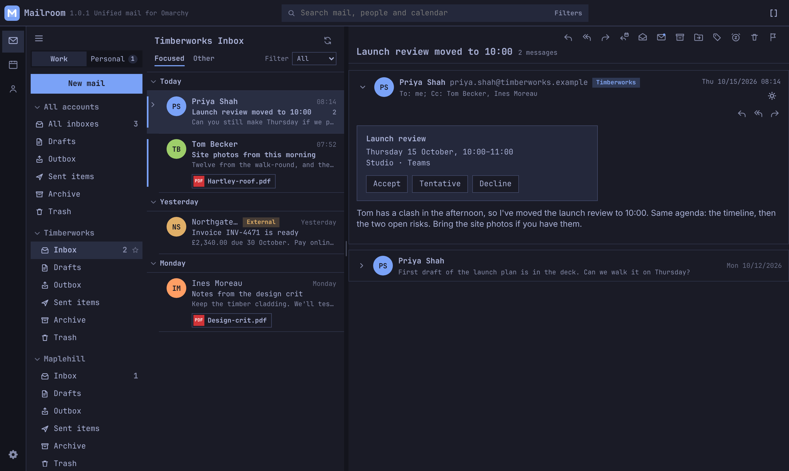
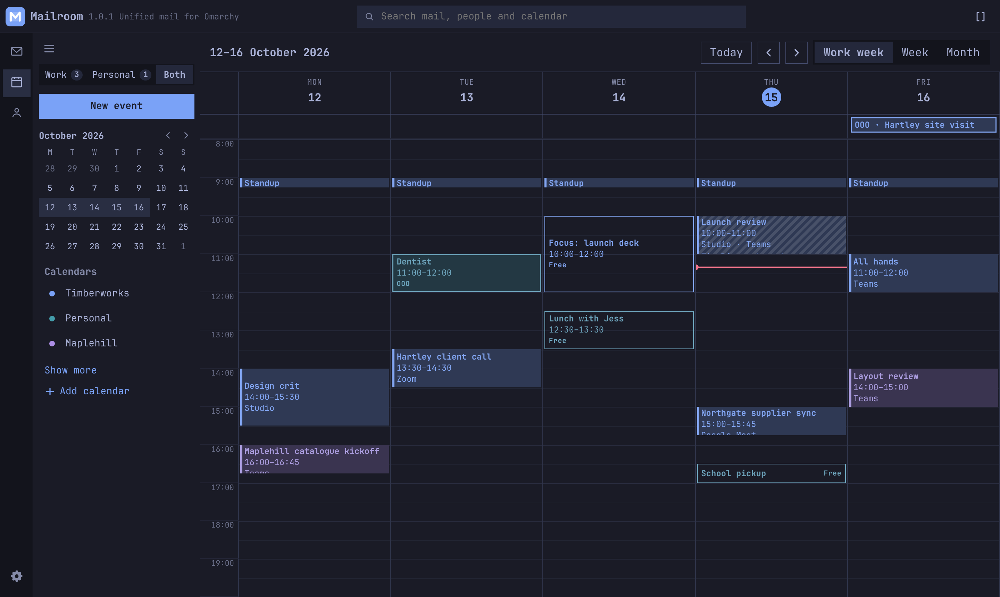
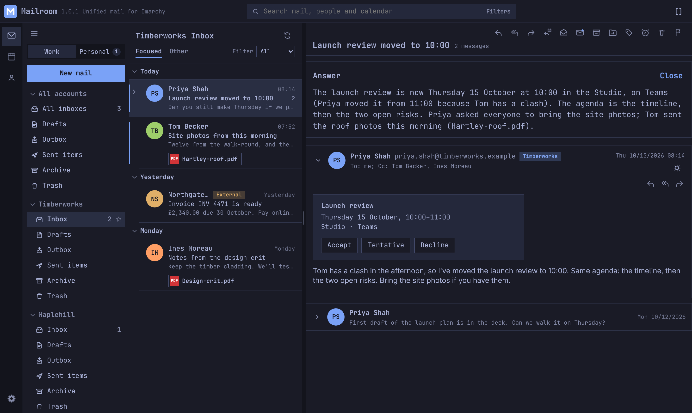
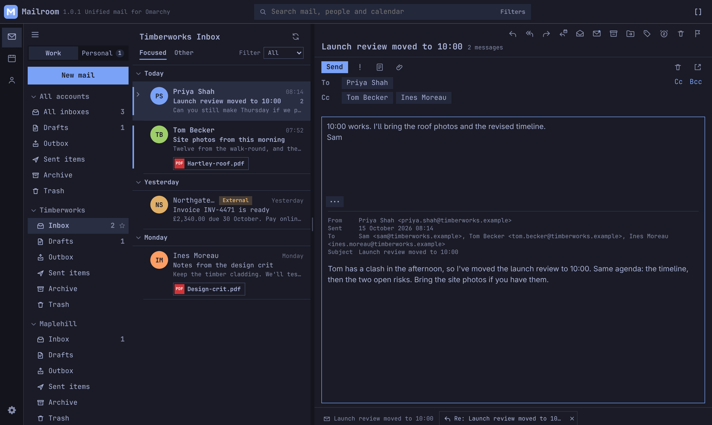
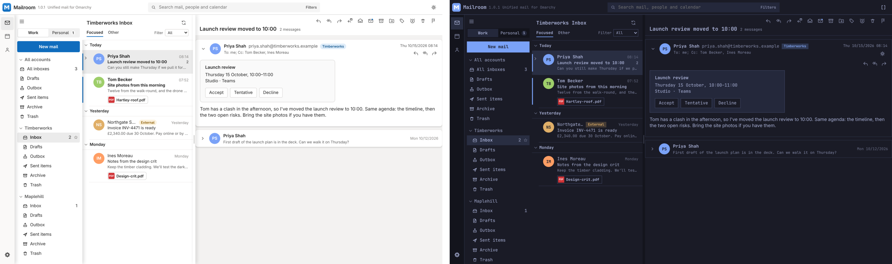
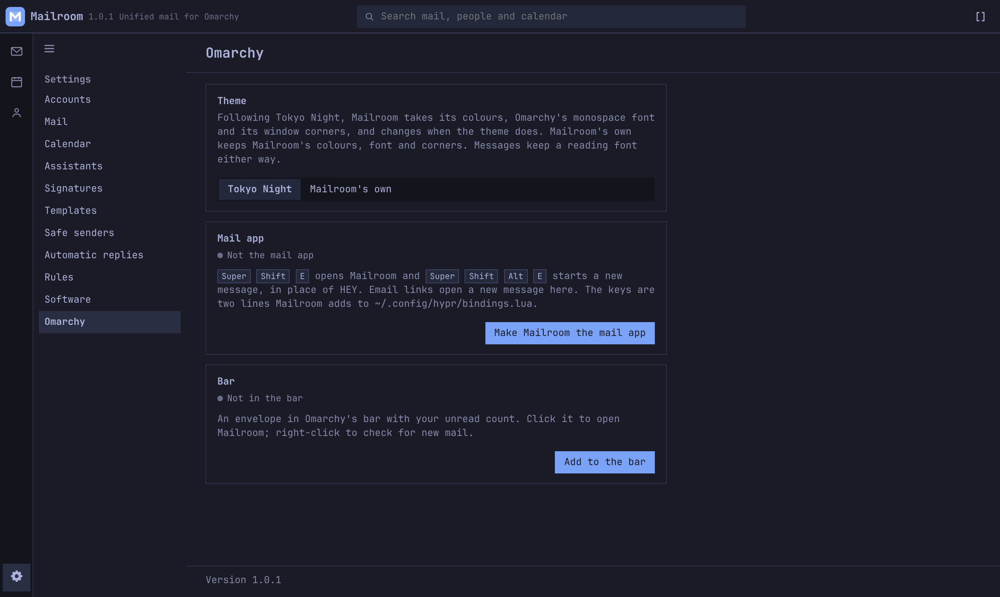

# Mailroom — unified mail for Omarchy

Every inbox you have, Microsoft 365, Outlook.com and Gmail, in one fast
desktop window that looks like the rest of your Omarchy desktop. With the
calendar, the Join button and the keyboard shortcuts you already know from
Outlook.



## What you get

On Linux, your work mail lives in a browser tab, your personal mail in
another, and the calendar in a third, and none of them feel like part of
your desktop. Mailroom is a native client that talks to Microsoft Graph and
the Gmail API directly, so it gets Focused Inbox, categories, rules, Teams
meetings and the rest, not a lowest-common-denominator IMAP view.

**A restomod, not a replica.** The layout, the shortcuts and the Join
button you know from Outlook, rebuilt as a native Linux app that wears your
Omarchy theme.

**All your accounts, one window.** Sign in to as many Microsoft 365,
Outlook.com and Gmail accounts as you have. Group them into Work and
Personal, flip between the two, or put both calendars side by side.

**Mail that reads properly.** Conversations, newest first, with your own
replies in place. Quoted history and legal footers fold away. Designed
newsletters turn dark with the rest of the app, colour by colour, and a sun
button shows the original. PDFs open in a built-in viewer. Remote pictures
stay blocked unless the sender is on your safe list, and the HTML is
sanitised before it is ever shown.

**A calendar you can live in.** Work week, week and month, every calendar in
its own colour. Answer invites, drag meetings to move them, edit one
occurrence or the whole series, see who's free and when (Microsoft), and
join Teams, Zoom, Google Meet or Webex from the reminder.



**Ask your mail.** Bring your own Claude or Grok key and "Help me write"
drafts, rewrites and shortens; "Ask" answers a question from every matching
message, PDF attachments included, and says what it left out. Nothing is
sent without you.



**Writing that behaves.** Undo send, send later, server drafts saved as you
type, templates, per-account signatures (pasted Outlook signatures keep
their look), pictures inline at the size you pick, spelling checked before
it goes. Reply-all builds To and Cc the way Outlook does. Enter never sends.



**Organised your way.** Archive, move with Undo, pin, snooze, flag, and
"remind me if nobody answers". Categories, rules, automatic replies and
search folders on Microsoft accounts. One search box for mail, people and
calendar that understands "3 march".

**Built for Omarchy.** Mailroom follows your Omarchy theme, font and window
corners, live. One click makes it the mail app: email links open here,
Super+Shift+E opens it, and an envelope with your unread count sits in the
bar. It still runs on any Linux desktop; the Omarchy parts only appear on
Omarchy.





**Private by design.** Mailroom talks straight from your machine to
Microsoft, Google and (only if you add a key) your AI provider. There is no
Mailroom server. Sign-in tokens live in the system keyring, and the mail
cache is a private SQLite file in your home folder.

**Keeps up with Outlook.** [FEATURES.md](FEATURES.md) lays Mailroom next to
the new Outlook, feature by feature. Every week a job reads Microsoft's
"What's new" pages and roadmap and opens an issue for anything Outlook has
that Mailroom doesn't.

## Checked every week

[](https://github.com/jonspinks/mailroom/actions/workflows/ci.yml)
[](https://github.com/jonspinks/mailroom/actions/workflows/stability.yml)
[](https://github.com/jonspinks/mailroom/actions/workflows/security.yml)
[](https://github.com/jonspinks/mailroom/actions/workflows/codeql.yml)
[](https://github.com/jonspinks/mailroom/actions/workflows/outlook-parity.yml)

- **Every change:** about 180 Rust tests and 105 browser tests, including
  hostile-mail cases (script, CSS tricks, tracking pixels) against the real
  Content Security Policy.
- **Weekly stability:** the full suites against the latest Rust and freshly
  updated dependencies, the browser tests three times over to catch flaky
  ones, and a release build.
- **Weekly security:** RustSec and npm advisories, a secret scan of the whole
  history, and GitHub CodeQL. Dependabot proposes dependency updates.
- **Weekly Outlook check:** see above.

## Works with

Microsoft 365 work or school accounts, Outlook.com / Hotmail / Live, and
Gmail or Google Workspace. Categories, rules, automatic replies, send later,
contacts and who's free are Microsoft-only for now. You register your own
free Microsoft and Google app to sign in with: it takes about ten minutes,
once, and the steps are under [Sign in](#sign-in).

## Build

Linux only. Install [Rust](https://rustup.rs) and WebKitGTK 4.1. On Arch:

```
sudo pacman -S --needed webkit2gtk-4.1 base-devel curl wget file openssl appmenu-gtk-module libappindicator-gtk3 librsvg xdotool hunspell-en_ca
```

On Debian or Ubuntu:

```
sudo apt install libwebkit2gtk-4.1-dev build-essential curl wget file libxdo-dev libssl-dev libayatana-appindicator3-dev librsvg2-dev hunspell-en-ca
```

Spell check needs the Canadian English dictionary, `hunspell-en_ca` on Arch and `hunspell-en-ca` on Debian and Ubuntu, which the commands above install. For another language, add its dictionary as well, such as `hunspell-en_gb` or `hunspell-en_us` on Arch, `hunspell-en-gb` or `hunspell-en-us` on Debian and Ubuntu. Choose the language in Settings > Mail.

British Columbia and Alberta stopped changing the clocks on 1 November 2026, and Manitoba moved to a permanent offset. The calendar follows this computer’s time zone. Those provinces need tzdata 2026b or later, so a weekly meeting stays on the hour it was booked.

Then, from a clone of this repository:

```
cargo build --manifest-path src-tauri/Cargo.toml
./src-tauri/target/debug/mailroom
```

The page is `index.html`, `styles.css` and `app.js`. Each build copies them into `dist/`.

For everyday use, build the release version. It starts faster and is much smaller than the debug build:

```
cargo build --release --manifest-path src-tauri/Cargo.toml
```

Point the launcher at `src-tauri/target/release/mailroom`. After pulling a new version, run the same command, or `scripts/mailroom-update`, which also restarts Mailroom.

## Install for everyday use

Keep a clone just for running Mailroom, apart from any clone you work in:

```
git clone https://github.com/jonspinks/mailroom.git ~/.local/opt/mailroom
cargo build --release --manifest-path ~/.local/opt/mailroom/src-tauri/Cargo.toml
ln -s ~/.local/opt/mailroom/scripts/mailroom-update ~/.local/bin/mailroom-update
```

Point the launcher entry at `~/.local/opt/mailroom/src-tauri/target/release/mailroom`, and add `--hidden` to start it in the tray at login. Settings > Software, or `mailroom-update`, updates it from then on.

## On Omarchy

Mailroom notices when it runs on [Omarchy](https://omarchy.org) (it looks for `~/.local/state/omarchy/current/theme/colors.toml`). Nowhere else does any of this happen.

- The chrome uses Omarchy's monospace font and Hyprland's window corners. Messages and compose keep a reading font.
- The theme menu gains **Omarchy (theme name)**, chosen for you the first time. Mailroom takes the theme's colours from `omarchy-theme-color` and changes when you switch theme, font or corners.
- There is no GTK titlebar, as Omarchy draws its own on floating workspaces. Pop-out windows are titled New message and Assistant, so a window rule can float them.
- **Settings > Omarchy** can make Mailroom the mail app: it installs a desktop entry and icon, takes `mailto:` links, and adds a marked block to `~/.config/hypr/bindings.lua` so Super+Shift+E opens Mailroom and Super+Shift+Alt+E starts a new message. The same page undoes it.
- It can also put an envelope with your unread count in Omarchy's bar (the shell plugin in `omarchy/plugin`). Click to open Mailroom, right-click to check for mail.

From a terminal, `mailroom mailto:someone@example.com`, `mailroom --compose` and `mailroom --check-mail` work on any desktop, and reach a Mailroom that is already running.

## Tests

`cargo test --manifest-path src-tauri/Cargo.toml` runs the Rust tests. The browser tests drive the page against a fake backend, so they never touch a real account:

```
cd e2e && npm install && node run.mjs
```

They need Chrome or Chromium (`CHROME` can point at one). GitHub runs both on every push.

To show the Mailroom logo in the app launcher, install the icon. The desktop entry uses `Icon=io.github.jonspinks.mailroom`.

```
install -Dm644 src-tauri/icons/icon.svg ~/.local/share/icons/hicolor/scalable/apps/io.github.jonspinks.mailroom.svg
for s in 32 128 256 512; do rsvg-convert -w $s -h $s src-tauri/icons/icon.svg -o ~/.local/share/icons/hicolor/${s}x${s}/apps/io.github.jonspinks.mailroom.png; done
```

## Sign in

Register a public client in Microsoft Entra. Do not create a client secret.

- Supported accounts: any organisational directory and personal Microsoft accounts.
- Platform: Mobile and desktop applications. Redirect URI `http://localhost`.
- Allow public client flows.
- Delegated permissions: `offline_access`, `User.Read`, `Mail.Read`, `Mail.ReadWrite`, `Mail.Send`, `Calendars.ReadWrite`, `Contacts.Read`, `Contacts.ReadWrite`, `MailboxSettings.ReadWrite`.

In the app, open Settings, save the application id, and add the account. A browser opens for Microsoft sign-in.

### Google accounts

Gmail and Google Calendar sign in through an OAuth client you make in the [Google Cloud console](https://console.cloud.google.com/):

- Create a project and turn on the Gmail API and the Google Calendar API.
- Set up the OAuth consent screen. Audience: External (personal Gmail) or Internal (one Workspace). Add yourself as a test user, and add the scopes `gmail.modify`, `calendar.events` and `calendar.calendarlist.readonly`.
- Create an OAuth client of the Desktop app type.

In the app, add an account, choose Google, and paste the client ID and secret (or the downloaded JSON file). An External app in Testing is signed out by Google every seven days; publish it to stay signed in, and pass the unverified-app warning once.

Gmail labels show as folders. A message lives in one: the Inbox while it is there, its label once archived, Archive when it has none. Categories, rules, automatic replies, send later, contacts and who's free stay Microsoft-only for now.

The screen is `index.html`. Scope that is not built yet is in `SPEC.md`.

## Not affiliated

Mailroom is an independent project. It is not made, endorsed or supported
by Microsoft or Google. Microsoft, Outlook and Microsoft 365 are trademarks
of Microsoft; Gmail is a trademark of Google.

## Licence

MIT. See [LICENSE](LICENSE).
